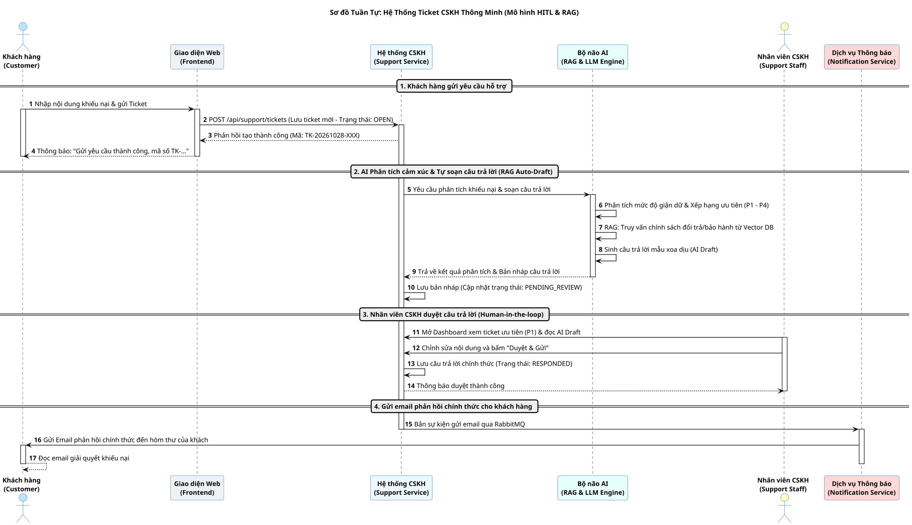

# CHƯƠNG 3: PHÂN TÍCH VÀ THIẾT KẾ HỆ THỐNG
## 3.4. THIẾT KẾ PHÂN HỆ HỖ TRỢ KHÁCH HÀNG VÀ TICKET CSKH THÔNG MINH

---

### 3.4.1. Phân tích yêu cầu phân hệ

#### 3.4.1.1. Yêu cầu chức năng (Functional Requirements)
Phân hệ Hỗ trợ khách hàng và Ticket thông minh (`support-service`) chịu trách nhiệm tiếp nhận, tự động phân loại, hỗ trợ nhân viên soạn thảo phản hồi và giải quyết khiếu nại của khách hàng. Các yêu cầu chức năng của phân hệ được chuẩn hóa tại Bảng 3.1.

*Bảng 3.1: Danh mục yêu cầu chức năng phân hệ CSKH*

| Mã FR | Tên chức năng | Tác nhân thực hiện | Mô tả chi tiết nghiệp vụ |
|:---:|---|:---:|---|
| **FR-01** | Tạo ticket hỗ trợ từ giao diện Web | Khách hàng | Khách hàng đã đăng nhập gửi biểu mẫu khiếu nại, bao gồm tiêu đề, nội dung, danh mục vấn đề, mã đơn hàng liên kết và tối đa 5 tệp hình ảnh minh chứng. |
| **FR-02** | Tự động chuyển tiếp từ Chatbot AI | Hệ thống (AI Shopping Assistant) | Chatbot tự động kích hoạt Tool Calling để khởi tạo ticket cấp bách kèm lịch sử phiên hội thoại (`chat_session_id`) khi phát hiện khách hàng bức xúc hoặc có yêu cầu gặp nhân viên. |
| **FR-03** | Phân tích cảm xúc văn bản | Hệ thống (AI Analyzer) | Tự động phân tích nội dung khiếu nại bằng mô hình ngôn ngữ lớn (LLM), xác định sắc thái cảm xúc (`ANGRY`, `FRUSTRATED`, `DISAPPOINTED`, `NEUTRAL`) và chấm điểm giận dữ từ 0 đến 100. |
| **FR-04** | Tự động phân hạng ưu tiên | Hệ thống (AI Analyzer) | Tự động gán mức độ ưu tiên (`P1 - Critical` đến `P4 - Low`) dựa trên điểm cảm xúc, phân loại nghiệp vụ và giá trị đơn hàng phát sinh tranh chấp. |
| **FR-05** | Tự động soạn thảo câu trả lời mẫu | Hệ thống (RAG Draft Generator) | Tự động truy vấn vector trên cơ sở tri thức chính sách sàn (`ai-service`), trích xuất các điều khoản liên quan và soạn thảo bản nháp email phản hồi thấu cảm. |
| **FR-06** | Quản trị và phê duyệt phản hồi (HITL) | Nhân viên CSKH / Admin | Cung cấp bảng điều khiển sắp xếp ticket theo mức độ ưu tiên, hiển thị bản nháp AI để nhân viên rà soát, chỉnh sửa và phê duyệt gửi thư. |
| **FR-07** | Phát thông báo email bất đồng bộ | Hệ thống (RabbitMQ & Notification) | Sau khi nhân viên phê duyệt, hệ thống phát sinh sự kiện qua hàng đợi thông điệp để gửi email chính thức đến khách hàng. |
| **FR-08** | Quản lý vòng đời trao đổi đa chiều | Khách hàng / Nhân viên | Khách hàng có thể tiếp tục phản hồi qua đường dẫn tra cứu; ticket tự động chuyển trạng thái để tiếp tục phiên hỗ trợ cho đến khi đóng thành công. |

#### 3.4.1.2. Yêu cầu phi chức năng (Non-Functional Requirements)
Các tiêu chuẩn kỹ thuật phi chức năng của phân hệ được quy định tại Bảng 3.2.

*Bảng 3.2: Danh mục yêu cầu phi chức năng*

| Tiêu chí | Thông số kỹ thuật cam kết | Giải pháp kỹ thuật thực hiện |
|---|---|---|
| **Tính tự trị (Autonomy)** | Khả năng độc lập đạt 100% về dữ liệu và vòng đời dịch vụ. | Áp dụng mô hình Database-per-Service với cơ sở dữ liệu `support_db` riêng biệt, liên kết lỏng qua UUID. |
| **Thời gian đáp ứng (Latency)** | Tiếp nhận yêu cầu: $T \le 150\text{ ms}$. Xử lý AI nền: $T \le 6\text{ s}$. | Phân tách xử lý AI thành tác vụ nền bất đồng bộ (Background Async Task), sử dụng HTTP Non-blocking I/O. |
| **Khả năng chịu lỗi (Resilience)** | Tỷ lệ sẵn sàng tiếp nhận đạt 99.9%. | Thiết lập cơ chế Graceful Degradation: Fallback về trạng thái thủ công khi dịch vụ AI bên ngoài gặp sự cố. |
| **Bảo mật & Phân quyền** | Toàn vẹn dữ liệu và kiểm soát truy cập nghiêm ngặt. | Xác thực chữ ký số JWT tại API Gateway; kiểm soát phân quyền dựa trên vai trò (Role-Based Access Control - RBAC). |

#### 3.4.1.3. Đặc tả ca sử dụng: Xử lý Ticket CSKH thông minh

- **Tên ca sử dụng:** Quản lý và xử lý yêu cầu hỗ trợ khách hàng (Ticket CSKH thông minh).
- **Mã định danh:** UC-SUPPORT-01.
- **Tác nhân chính:** Khách hàng (Customer), Nhân viên CSKH (Support Staff).
- **Tác nhân phụ:** Dịch vụ LLM API (OpenAI / Gemini), Dịch vụ Email (SMTP qua `notification-service`), Dịch vụ lưu trữ Cloudinary.
- **Điều kiện tiên quyết:**
  - Khách hàng đã được xác thực danh tính thông qua JWT Token hợp lệ.
  - Nhân viên CSKH đã đăng nhập hệ thống với vai trò `STAFF` hoặc `ADMIN`.
  - Các dịch vụ `support-service`, `ai-service`, `notification-service` và RabbitMQ đang hoạt động.
- **Luồng sự kiện chính (Happy Path):**
  1. Khách hàng truy cập biểu mẫu hỗ trợ tại đường dẫn `/support/new-ticket`, nhập tiêu đề, nội dung khiếu nại, phân loại nghiệp vụ và chọn mã đơn hàng liên quan.
  2. Khách hàng đính kèm hình ảnh minh chứng. Hệ thống tải tệp lên dịch vụ Cloudinary thông qua API `POST /api/support/upload` và nhận về các URL lưu trữ.
  3. Khách hàng nhấn xác nhận gửi biểu mẫu. Giao diện gửi yêu cầu `POST /api/support/tickets` qua API Gateway đến `support-service`.
  4. `support-service` kiểm tra dữ liệu đầu vào, khởi tạo bản ghi trong `support_db` với mã hiển thị chuẩn `TK-YYYYMMDD-XXX` và trạng thái khởi tạo `OPEN`.
  5. Hệ thống kích hoạt tác vụ nền, chuyển trạng thái ticket sang `ANALYZING`.
  6. Khối AI Analyzer phân tích nội dung khiếu nại, xác định cảm xúc (`ANGRY`, `FRUSTRATED`, `DISAPPOINTED`, `NEUTRAL`), chấm điểm giận dữ `sentiment_score` (0 - 100), phân hạng ưu tiên (`P1` đến `P4`) và trích xuất câu tóm tắt sự cố.
  7. Khối Draft Generator gửi câu tóm tắt sang `ai-service` (`POST /api/ai/rag/query`) để tìm kiếm Top 3 đoạn trích chính sách liên quan nhất từ kho tri thức vector `pgvector`.
  8. Hệ thống tổng hợp ngữ cảnh chính sách và gọi LLM sinh bản nháp email phản hồi mẫu (`ai_draft`) kèm chỉ số tự tin (`ai_confidence`).
  9. Hệ thống lưu bản nháp vào bảng `ticket_responses` và chuyển trạng thái ticket sang `PENDING_REVIEW`.
  10. Nhân viên CSKH truy cập Agent Dashboard (`/admin/tickets`), hệ thống tự động hiển thị danh sách ưu tiên với các ticket P1/khách hàng bức xúc ở vị trí đầu tiên.
  11. Nhân viên mở chi tiết ticket, rà soát nội dung khiếu nại, hình ảnh và câu trả lời gợi ý của AI. Nhân viên biên tập lại nội dung cho phù hợp thực tế và nhấn "Duyệt & Gửi" (`POST /api/support/admin/tickets/:id/approve-and-send`).
  12. Hệ thống lưu nội dung phản hồi chính thức (`final_response`), chuyển trạng thái ticket sang `RESPONDED`, phát sự kiện `support.ticket_responded` lên RabbitMQ để `notification-service` gửi email hoàn tất tới khách hàng.
- **Luồng sự kiện thay thế (Alternative Paths):**
  - *Kịch bản A (Tự động chuyển tiếp từ Chatbot AI):* Khi khách hàng thể hiện thái độ bức xúc trong phiên chat mua sắm, Chatbot kích hoạt Tool Calling gọi `POST /api/support/tickets/escalate`. Hệ thống khởi tạo ticket với `source = 'AI_ESCALATE'` và liên kết `chat_session_id`. Khách hàng nhận thông báo tiếp nhận khẩn cấp trực tiếp trên cửa sổ chat.
  - *Kịch bản B (Xử lý sự cố dịch vụ AI):* Tại bước 6 hoặc 8, nếu dịch vụ LLM bị gián đoạn hoặc chỉ số `ai_confidence < 50%`, hệ thống tự động chuyển trạng thái ticket về `OPEN` và kích hoạt cờ cảnh báo yêu cầu nhân viên soạn thảo thủ công.
  - *Kịch bản C (Nhân viên từ chối bản nháp):* Tại bước 11, nếu bản nháp không đạt yêu cầu, nhân viên nhấn từ chối bản nháp và tự soạn thảo câu trả lời mới trong khung nhập liệu.

---

### 3.4.2. Thiết kế kiến trúc phân hệ

#### 3.4.2.1. Vị trí phân hệ trong kiến trúc vi dịch vụ tổng thể
Phân hệ `support-service` được triển khai tại cổng mạng nội bộ 3009, đóng vai trò độc lập trong mô hình kiến trúc hướng dịch vụ (SOA). Sơ đồ kiến trúc tổng thể được thể hiện tại Hình 3.1.

```
┌──────────────────────────────────────────────────────────────────────────────────┐
│                                FRONTEND (React)                                  │
│       [User Support Form]              │          [Agent Dashboard - HITL]       │
└────────────────────────────────────────┼─────────────────────────────────────────┘
                                         ▼
┌──────────────────────────────────────────────────────────────────────────────────┐
│                             API GATEWAY (Port 3000)                              │
│                    JWT Verification & Service Reverse Proxy                      │
└────────────────────────────────────────┬─────────────────────────────────────────┘
                                         ▼
┌──────────────────────────────────────────────────────────────────────────────────┐
│                           SUPPORT-SERVICE (Port 3009)                            │
│                                                                                  │
│   ┌────────────────────┐   ┌─────────────────────┐   ┌───────────────────────┐   │
│   │ Ticket Controller  │   │ AI Sentiment Engine │   │ RAG Draft Generator   │   │
│   └─────────┬──────────┘   └──────────┬──────────┘   └───────────┬───────────┘   │
│             │                         │                          │               │
│             ▼                         ▼                          ▼               │
│   ┌──────────────────────────────────────────────────────────────────────────┐   │
│   │                       support_db (PostgreSQL 16)                         │   │
│   │                 [tickets]  [ticket_messages]  [ticket_responses]         │   │
│   └──────────────────────────────────────────────────────────────────────────┘   │
└──────────────┬────────────────────────┬──────────────────────────┬───────────────┘
               │                        │                          │
        (REST Internal)           (External API)              (AMQP Events)
               ▼                        ▼                          ▼
     ┌──────────────────┐     ┌───────────────────┐      ┌──────────────────┐
     │    ai-service    │     │  LLM Provider API │      │     RabbitMQ     │
     │   (RAG Engine)   │     │ (OpenAI / Gemini) │      │ (Exchange Topic) │
     │    Port 3010     │     └───────────────────┘      └─────────┬────────┘
     └──────────────────┘                                          ▼
                                                         ┌──────────────────┐
                                                         │ notification-svc │
                                                         │ (SendGrid / SMTP)│
                                                         └──────────────────┘
```
*Hình 3.1: Vị trí của support-service trong kiến trúc Microservices tổng thể*

#### 3.4.2.2. Kiến trúc phân tầng của vi dịch vụ `support-service`
Mã nguồn dịch vụ được tổ chức theo chuẩn kiến trúc phân tầng (Layered Architecture):
1. **Tầng Giao tiếp (Controller Layer):** Định tuyến HTTP Request từ API Gateway, thực hiện xác thực Schema dữ liệu bằng thư viện Zod, phân quyền người dùng và định dạng HTTP Response.
2. **Tầng Nghiệp vụ (Service Layer):** Đảm nhiệm logic điều phối máy trạng thái, kích hoạt tác vụ phân tích cảm xúc, kết nối RAG Engine và điều phối thông điệp RabbitMQ.
3. **Tầng Truy xuất Dữ liệu (Repository Layer):** Đóng gói các thao tác CRUD và Transaction với cơ sở dữ liệu `support_db` thông qua Prisma ORM.
4. **Tầng Tích hợp Ngoại vi (Integration Layer):** Chứa các Client giao tiếp với bên thứ ba: SDK gọi mô hình LLM, REST Client kết nối `ai-service` và AMQP Channel kết nối RabbitMQ.

#### 3.4.2.3. Máy trạng thái hữu hạn và vòng đời xử lý Ticket
Chu trình xử lý một yêu cầu hỗ trợ được mô hình hóa thành một Máy trạng thái hữu hạn (FSM) nhằm đảm bảo tính toàn vẹn trạng thái như minh họa tại Hình 3.2.

```
  [Khởi tạo Ticket]
         │
         ▼
     ┌──────┐
     │ OPEN │ ──(Kích hoạt AI nền)──► ┌───────────┐
     └──────┘                         │ ANALYZING │
                                      └─────┬─────┘
                                            │
          ┌─────────────────────────────────┴─────────────────────────────────┐
          ▼ (Phân tích & RAG thành công)                                      ▼ (AI gặp sự cố / Timeout)
 ┌────────────────┐                                                    ┌──────────────┐
 │ PENDING_REVIEW │ ◄──────────────────(Nhân viên nhận ca)─────────────┤     OPEN     │
 └───────┬────────┘                                                    └──────────────┘
         │
         ▼ (Nhân viên bấm "Duyệt & Gửi")
 ┌────────────────┐
 │   RESPONDED    │
 └───────┬────────┘
         │
         ├──────────────────────────────────────────────────┐
         ▼ (Khách hàng gửi thêm phản hồi)                   ▼ (Khách hài lòng / Sau 48h)
  ┌──────────────┐                                   ┌──────────────┐
  │   REOPENED   │                                   │   RESOLVED   │
  └──────────────┘                                   └──────────────┘
```
*Hình 3.2: Sơ đồ máy trạng thái hữu hạn của Ticket*

- **`OPEN`:** Trạng thái khởi tạo khi tiếp nhận yêu cầu từ người dùng.
- **`ANALYZING`:** Trạng thái khóa tạm thời trong thời gian hệ thống kích hoạt xử lý AI nền.
- **`PENDING_REVIEW`:** Trạng thái chờ nhân viên CSKH kiểm duyệt bản nháp trên bảng điều khiển.
- **`RESPONDED`:** Trạng thái đã gửi thư phản hồi chính thức cho khách hàng.
- **`REOPENED`:** Trạng thái mở lại tự động khi khách hàng gửi phản hồi bổ sung sau khi nhận thư.
- **`RESOLVED`:** Trạng thái đóng thành công khi khiếu nại được giải quyết dứt điểm.
- **`CLOSED`:** Trạng thái đóng cưỡng bức bởi quản trị viên đối với các yêu cầu không hợp lệ hoặc spam.

---

### 3.4.3. Thiết kế cơ sở dữ liệu

#### 3.4.3.1. Nguyên tắc thiết kế Database-per-Service
Cơ sở dữ liệu `support_db` được xây dựng độc lập trên hệ quản trị PostgreSQL phiên bản 16. Để đảm bảo tính phân tán và tự trị, cơ sở dữ liệu tuân thủ các nguyên tắc:
- Không tạo khóa ngoại vật lý (Foreign Key) tham chiếu trực tiếp sang các cơ sở dữ liệu khác (`identity_db`, `order_db`).
- Các liên kết giữa các miền nghiệp vụ được thực hiện thông qua trường khóa định danh toàn cục UUID (`customer_id`, `related_order_id`, `staff_id`).
- Khóa chính của bảng nghiệp vụ chính sử dụng UUIDv4 tự sinh bằng hàm `gen_random_uuid()` của hệ thống.

#### 3.4.3.2. Mô hình quan hệ thực thể (ERD)
Sơ đồ quan hệ thực thể giữa 3 bảng dữ liệu cốt lõi được mô tả tại Hình 3.3.

```
┌──────────────────────────────────────┐
│               tickets                │
├──────────────────────────────────────┤
│ PK  id               UUID            │
│     ticket_number    VARCHAR(20) [U] │
│     customer_id      UUID            │
│     customer_email   VARCHAR(255)    │
│     customer_name    VARCHAR(255)    │
│     subject          VARCHAR(500)    │
│     category         VARCHAR(50)     │
│     related_order_id UUID            │
│     source           VARCHAR(30)     │
│     chat_session_id  UUID            │
│     sentiment        VARCHAR(30)     │
│     sentiment_score  INT             │
│     priority         VARCHAR(10)     │
│     status           VARCHAR(30)     │
│     assigned_to      UUID            │
│     created_at       TIMESTAMPTZ     │
│     updated_at       TIMESTAMPTZ     │
└──────────────────┬───────────────────┘
                   │ 1
                   │
                   ├───────────────────────────────────┐
                 N │                                 1 │
┌──────────────────▼───────────────────┐   ┌───────────▼──────────────────────┐
│           ticket_messages            │   │         ticket_responses         │
├──────────────────────────────────────┤   ├──────────────────────────────────┤
│ PK  id               BIGSERIAL       │   │ PK  id               BIGSERIAL   │
│ FK  ticket_id        UUID            │   │ FK  ticket_id        UUID        │
│     sender_type      VARCHAR(20)     │   │     ai_draft         TEXT        │
│     sender_id        UUID            │   │     rag_chunks_used  JSONB       │
│     content          TEXT            │   │     ai_tone          VARCHAR(30) │
│     attachments      JSONB           │   │     ai_confidence    INT         │
│     created_at       TIMESTAMPTZ     │   │     staff_id         UUID        │
└──────────────────────────────────────┘   │     final_response   TEXT        │
                                           │     staff_notes      TEXT        │
                                           │     sent_at          TIMESTAMPTZ │
                                           │     created_at       TIMESTAMPTZ │
                                           └──────────────────────────────────┘
```
*Hình 3.3: Sơ đồ quan hệ thực thể (ERD) của phân hệ support_db*

#### 3.4.3.3. Đặc tả cấu trúc các bảng dữ liệu

*Bảng 3.3: Cấu trúc dữ liệu bảng tickets*

| Tên trường | Kiểu dữ liệu | Ràng buộc | Mục đích & Mô tả |
|---|---|---|---|
| `id` | `UUID` | PK, Default `gen_random_uuid()` | Khóa chính duy nhất định danh bản ghi ticket. |
| `ticket_number` | `VARCHAR(20)` | UNIQUE, NOT NULL | Mã tra cứu thân thiện cho khách hàng dạng `TK-YYYYMMDD-XXX`. |
| `customer_id` | `UUID` | NOT NULL | UUID định danh khách hàng trích xuất từ JWT Token. |
| `customer_email`| `VARCHAR(255)` | NOT NULL | Địa chỉ hộp thư tiếp nhận email giải quyết khiếu nại. |
| `customer_name` | `VARCHAR(255)` | NULL | Tên hiển thị của khách hàng để chèn vào nội dung thư. |
| `subject` | `VARCHAR(500)` | NOT NULL | Tiêu đề tóm lược nội dung yêu cầu hỗ trợ. |
| `category` | `VARCHAR(50)` | Default `'OTHER'` | Phân loại nghiệp vụ (`REFUND`, `WARRANTY`, `SHIPPING`, `PAYMENT`, `OTHER`). |
| `related_order_id`| `UUID` | NULL | Liên kết mã đơn hàng phát sinh tranh chấp (nếu có). |
| `source` | `VARCHAR(30)` | NOT NULL, Default `'FORM'` | Kênh mở ticket (`FORM` hoặc `AI_ESCALATE`). |
| `chat_session_id` | `UUID` | NULL | Định danh phiên chat gốc nếu phát sinh từ Chatbot AI. |
| `sentiment` | `VARCHAR(30)` | NULL | Kết quả phân loại cảm xúc (`ANGRY`, `FRUSTRATED`, `DISAPPOINTED`, `NEUTRAL`). |
| `sentiment_score`| `INT` | NULL | Thang đo độ giận dữ (giá trị nguyên từ 0 đến 100). |
| `priority` | `VARCHAR(10)` | Default `'P3'` | Thứ tự ưu tiên giải quyết (`P1`, `P2`, `P3`, `P4`). |
| `status` | `VARCHAR(30)` | Default `'OPEN'` | Trạng thái hiện tại trong máy trạng thái FSM. |
| `assigned_to` | `UUID` | NULL | Định danh nhân viên CSKH được phân công tiếp nhận. |
| `created_at` | `TIMESTAMPTZ` | Default `NOW()` | Thời điểm khởi tạo bản ghi. |
| `updated_at` | `TIMESTAMPTZ` | Default `NOW()` | Thời điểm cập nhật trạng thái gần nhất. |

*Bảng 3.4: Cấu trúc dữ liệu bảng ticket_messages*

| Tên trường | Kiểu dữ liệu | Ràng buộc | Mục đích & Mô tả |
|---|---|---|---|
| `id` | `BIGSERIAL` | PK | Khóa chính tự tăng của tin nhắn. |
| `ticket_id` | `UUID` | FK `tickets(id)`, CASCADE | Tham chiếu đến ticket tương ứng. |
| `sender_type` | `VARCHAR(20)` | NOT NULL | Loại đối tượng gửi (`CUSTOMER`, `STAFF`, hoặc `SYSTEM`). |
| `sender_id` | `UUID` | NULL | Định danh đối tượng gửi tin nhắn. |
| `content` | `TEXT` | NOT NULL | Toàn văn nội dung tin nhắn trao đổi. |
| `attachments` | `JSONB` | NULL | Danh sách mảng link ảnh lưu trữ Cloudinary `[{url, name, size}]`. |
| `created_at` | `TIMESTAMPTZ` | Default `NOW()` | Thời điểm ghi nhận tin nhắn. |

*Bảng 3.5: Cấu trúc dữ liệu bảng ticket_responses*

| Tên trường | Kiểu dữ liệu | Ràng buộc | Mục đích & Mô tả |
|---|---|---|---|
| `id` | `BIGSERIAL` | PK | Khóa chính tự tăng của bản ghi phản hồi. |
| `ticket_id` | `UUID` | FK `tickets(id)`, CASCADE | Tham chiếu đến ticket được xử lý. |
| `ai_draft` | `TEXT` | NOT NULL | Nội dung câu trả lời do AI tự động soạn thảo mẫu. |
| `rag_chunks_used`| `JSONB` | NULL | Mảng lưu trữ thông tin các đoạn chính sách AI đã trích dẫn. |
| `ai_tone` | `VARCHAR(30)` | NULL | Giọng văn AI áp dụng (`APOLOGETIC`, `EMPATHETIC`, `INFORMATIVE`). |
| `ai_confidence`| `INT` | NOT NULL | Chỉ số tự tin của AI (từ 0 đến 100). |
| `staff_id` | `UUID` | NULL | Định danh nhân viên CSKH thực hiện phê duyệt. |
| `final_response`| `TEXT` | NULL | Nội dung phản hồi chính thức sau khi nhân viên biên tập. |
| `staff_notes` | `TEXT` | NULL | Ghi chú nghiệp vụ nội bộ giữa các nhân viên. |
| `sent_at` | `TIMESTAMPTZ` | NULL | Thời điểm hoàn tất gửi email thông báo. |

#### 3.4.3.4. Chiến lược đánh chỉ mục tối ưu truy vấn
Để tối ưu hóa hiệu năng truy vấn cho bảng điều khiển quản trị và lịch sử tra cứu của khách hàng, các chỉ mục phức hợp (Composite Indexes) được thiết lập như sau:
```sql
-- Chỉ mục phục vụ Agent Dashboard lọc theo trạng thái và ưu tiên P1
CREATE INDEX idx_tickets_priority_status_created 
ON tickets(priority ASC, status, created_at DESC);

-- Chỉ mục phục vụ tra cứu lịch sử yêu cầu của khách hàng
CREATE INDEX idx_tickets_customer_created 
ON tickets(customer_id, created_at DESC);

-- Chỉ mục tối ưu tải danh sách trao đổi theo từng ticket
CREATE INDEX idx_ticket_messages_ticket_created 
ON ticket_messages(ticket_id, created_at ASC);
```

---

### 3.4.4. Thiết kế các khối xử lý thông minh (AI & RAG Engine Design)

#### 3.4.4.1. Khối phân tích cảm xúc và phân hạng ưu tiên (AI Sentiment Analyzer)
Khối phân tích cảm xúc vận hành độc lập thông qua lời gọi LLM API. Hệ thống truyền nội dung khiếu nại vào khuôn mẫu System Prompt có cấu trúc nghiêm ngặt nhằm thu về đối tượng JSON định dạng chuẩn:
```json
{
  "sentiment": "ANGRY",
  "sentiment_score": 88,
  "priority": "P1",
  "category": "REFUND",
  "summary": "Khách hàng yêu cầu hoàn tiền gấp do đơn hàng trễ 5 ngày và không liên hệ được vận chuyển."
}
```

Ma trận phân hạng mức độ ưu tiên nghiệp vụ được quy định chi tiết tại Bảng 3.6.

*Bảng 3.6: Ma trận phân hạng ưu tiên*

| Mức ưu tiên | Điều kiện điểm cảm xúc | Điều kiện nghiệp vụ bổ sung | Thời gian phản hồi cam kết (SLA) |
|:---:|---|---|:---:|
| **P1 (Critical)** | `sentiment_score` $\ge 80$ | Khiếu nại sai lệch tiền bạc (`REFUND`, `PAYMENT lỗi`) hoặc đe dọa khiếu kiện. | $\le 15\text{ phút}$ |
| **P2 (High)** | `sentiment_score` từ 60 đến 79 | Đơn hàng trễ hẹn giao quá 3 ngày; hàng nhận được bị vỡ hỏng nặng. | $\le 2\text{ giờ}$ |
| **P3 (Medium)** | `sentiment_score` từ 40 đến 59 | Yêu cầu hỗ trợ quy trình đổi kích cỡ, đổi màu sản phẩm thông thường. | $\le 8\text{ giờ}$ |
| **P4 (Low)** | `sentiment_score` $< 40$ | Hỏi thông tin quy định bảo hành chung, cách kích hoạt khuyến mãi. | $\le 24\text{ giờ}$ |

#### 3.4.4.2. Khối truy vấn tri thức và tự động soạn thảo (RAG Auto-Draft)
Cơ chế Retrieval-Augmented Generation (RAG) bảo đảm câu trả lời do AI đề xuất bám sát 100% chính sách nội bộ của sàn thương mại điện tử. Sơ đồ quy trình được mô tả tại Hình 3.4.

```
┌─────────────────────────────────┐      POST /api/ai/rag/query       ┌───────────────────────────────┐
│ AI Analyzer trích xuất summary  │ ────────────────────────────────► │ ai-service (PostgreSQL Vector) │
└─────────────────────────────────┘                                   └──────────────┬────────────────┘
                                                                                     │ Cosine Similarity >= 0.70
                                                                                     ▼
┌─────────────────────────────────┐        Prompt Augmentation        ┌───────────────────────────────┐
│ LLM sinh câu trả lời thấu cảm   │ ◄──────────────────────────────── │ Trích xuất Top 3 Chunks       │
│ (ai_draft + ai_confidence)      │                                   │ chính sách đổi trả / bảo hành │
└─────────────────────────────────┘                                   └───────────────────────────────┘
```
*Hình 3.4: Quy trình xử lý RAG Auto-Draft*

Công thức tìm kiếm tương đồng vector Cosine được thực thi trực tiếp trên extension `pgvector`:
$$\text{Cosine Similarity}(\mathbf{u}, \mathbf{v}) = \frac{\mathbf{u} \cdot \mathbf{v}}{\|\mathbf{u}\| \|\mathbf{v}\|} = \frac{\sum_{i=1}^{n} u_i v_i}{\sqrt{\sum_{i=1}^{n} u_i^2} \sqrt{\sum_{i=1}^{n} v_i^2}} \quad (3.1)$$

Các đoạn văn bản có độ tương đồng $\ge 0.70$ được ghép nối vào Draft Prompt với các quy tắc:
1. Trường hợp khách hàng có trạng thái `ANGRY`: Bắt buộc mở đầu thư bằng sự chia sẻ chân thành và lời xin lỗi về sự bất tiện.
2. Trích dẫn chuẩn xác điều khoản quy định (ví dụ: *"Căn cứ theo Điều 3.1 Chính sách Hoàn tiền..."*).
3. Đưa ra thời hạn giải quyết dứt điểm (ví dụ: *"Thời gian xử lý hoàn tiền từ 3 đến 5 ngày làm việc"*).

#### 3.4.4.3. Quy trình cộng tác Người - Máy (Human-in-the-loop Workflow)
Mô hình Human-in-the-loop (HITL) được hiện thực hóa trên Agent Dashboard:
- **Cơ chế Phân loại Trực quan:** Các ticket P1 luôn ghim trên đỉnh danh sách với khung viền đỏ nổi bật và chỉ báo mức độ khẩn cấp.
- **Cơ chế Kiểm soát Độ tin cậy:** Nếu chỉ số `ai_confidence < 50%`, giao diện hiển thị cảnh báo vàng: *"AI không đủ dữ liệu chính sách để khẳng định câu trả lời, yêu cầu nhân viên tra cứu kỹ lưỡng"*.
- **Tối ưu hóa năng suất:** Với các trường hợp đạt độ tin cậy cao, nhân viên chỉ mất trung bình 3 đến 5 giây để rà soát và nhấn **"Duyệt & Gửi"**, loại bỏ hoàn toàn thao tác tra cứu tài liệu và soạn văn bản thủ công.

---

### 3.4.5. Thiết kế giao tiếp và tích hợp hệ thống

#### 3.4.5.1. Đặc tả giao diện lập trình ứng dụng RESTful API
Hệ thống cung cấp danh mục các điểm cuối API được phân loại theo quyền truy cập tại Bảng 3.7.

*Bảng 3.7: Danh mục API Endpoints phân hệ Support*

| Phương thức | Đường dẫn Endpoint | Quyền hạn | Chức năng nghiệp vụ |
|:---:|---|:---:|---|
| `POST` | `/api/support/tickets` | Khách hàng | Khởi tạo ticket khiếu nại mới từ biểu mẫu web. |
| `GET` | `/api/support/tickets` | Khách hàng | Lấy danh sách lịch sử ticket của người dùng hiện tại. |
| `GET` | `/api/support/tickets/:id` | Khách hàng / Nhân viên | Xem chi tiết tiến độ xử lý và các tin nhắn trong ticket. |
| `POST` | `/api/support/tickets/:id/messages` | Khách hàng / Nhân viên | Gửi tin nhắn trao đổi bổ sung vào phiên hỗ trợ. |
| `GET` | `/api/support/admin/tickets` | Nhân viên / Admin | Lấy danh sách ticket quản trị phục vụ màn hình duyệt HITL. |
| `POST` | `/api/support/admin/tickets/:id/approve-and-send`| Nhân viên | Phê duyệt bản nháp và kích hoạt luồng phát sự kiện gửi email. |
| `PUT` | `/api/support/admin/tickets/:id/status` | Nhân viên / Admin | Cập nhật thủ công trạng thái (`CLOSED`, `RESOLVED`). |
| `POST` | `/api/support/tickets/escalate` | Nội bộ (`ai-service`)| API nội bộ tiếp nhận yêu cầu chuyển tiếp khẩn cấp từ Chatbot AI. |

#### 3.4.5.2. Tích hợp bất đồng bộ hướng sự kiện qua Message Broker (RabbitMQ)
Nhằm tránh tình trạng nghẽn I/O tại tiến trình web khi thực thi gửi email, hệ thống thiết lập kiến trúc Event-Driven:
- **Exchange:** `support.events` (Topic Exchange).
- **Routing Key:** `support.ticket.responded`.
- **Hàng đợi tiếp nhận:** `support_email_notifications_queue` (thuộc vi dịch vụ `notification-service`).

Cấu trúc bản tin sự kiện được chuẩn hóa như sau:
```json
{
  "event_id": "evt-88219412-41a3",
  "event_type": "TICKET_RESPONDED",
  "occurred_at": "2026-10-28T10:15:30.123Z",
  "payload": {
    "ticket_number": "TK-20261028-021",
    "customer_email": "khachhang@gmail.com",
    "customer_name": "Nguyễn Văn A",
    "subject": "Phản hồi yêu cầu hỗ trợ đơn hàng #8a7b6c5d",
    "final_response": "Kính gửi quý khách Nguyễn Văn A, chúng tôi chân thành xin lỗi...",
    "staff_name": "Trần Thị CSKH"
  }
}
```

Cơ chế chống thất lạc thông điệp: Hàng đợi được cấu hình với cờ `durable = true`. Trường hợp dịch vụ gửi thư gặp sự cố, thông điệp tự động kích hoạt cơ chế Dead Letter Queue (DLQ) qua exchange `support.events.dlx` sau 3 lần thử lại thất bại theo thuật toán Exponential Backoff.

#### 3.4.5.3. Sơ đồ tuần tự xử lý nghiệp vụ (Sequence Diagram)
Sơ đồ tuần tự thể hiện sự phối hợp xử lý giữa các thành phần được mô tả chi tiết tại Hình 3.5.


*Hình 3.5: Sơ đồ tuần tự xử lý Ticket CSKH thông minh*

---

### 3.4.6. Kiểm thử và đánh giá kết quả

#### 3.4.6.1. Kịch bản kiểm thử chức năng và xử lý sự cố
Kết quả kiểm thử nghiệm thu 7 kịch bản nghiệp vụ chính được tổng hợp tại Bảng 3.8.

*Bảng 3.8: Ma trận kiểm thử các kịch bản nghiệp vụ*

| Mã TC | Kịch bản kiểm thử | Dữ liệu kiểm thử đầu vào | Kết quả kỳ vọng | Trạng thái |
|:---:|---|---|---|:---:|
| **TC-01** | Khách hàng mở ticket kèm hình ảnh | Khiếu nại nứt vỡ + 2 file ảnh JPG | Tạo ticket thành công mã `TK-xxx`, ảnh lưu trữ an toàn trên Cloudinary, trạng thái `OPEN`. | **ĐẠT** |
| **TC-02** | Xử lý tình huống khách hàng giận dữ | "Tôi đợi 7 ngày chưa nhận được hàng, hoàn tiền ngay!" | Phân tích cảm xúc `ANGRY` (Score: 88), xếp hạng `P1`, bản nháp trích dẫn đúng chính sách hoàn tiền. | **ĐẠT** |
| **TC-03** | Khách hàng hỏi thông tin chính sách | "Quy định đổi trả hàng áp dụng trong bao lâu?" | Phân tích cảm xúc `NEUTRAL` (Score: 12), xếp hạng `P4`, bản nháp trích dẫn thời hạn 7 ngày. | **ĐẠT** |
| **TC-04** | Chatbot AI tự động chuyển tiếp | Đoạn hội thoại bức xúc trên widget chat | Tạo ticket nguồn `'AI_ESCALATE'`, lưu đúng `chat_session_id`, phản hồi mã ticket trên cửa sổ chat. | **ĐẠT** |
| **TC-05** | Phê duyệt bản nháp theo mô hình HITL | Nhân viên chỉnh sửa nhẹ và bấm duyệt | Cập nhật trạng thái `RESPONDED`, RabbitMQ phát sự kiện, khách hàng nhận email hoàn chỉnh. | **ĐẠT** |
| **TC-06** | Khách hàng gửi phản hồi bổ sung | Khách hàng gửi tin nhắn qua liên kết tra cứu | Ticket tự động chuyển trạng thái `REOPENED`, đưa trở lại đầu hàng đợi trên bảng điều khiển. | **ĐẠT** |
| **TC-07** | Xử lý sự cố dịch vụ LLM bị timeout | Ngắt kết nối mạng mô phỏng ra API ngoài | Ticket tự động chuyển về trạng thái `OPEN`, hiển thị cảnh báo vàng, không gây treo giao diện. | **ĐẠT** |

#### 3.4.6.2. Đánh giá tính an toàn của mô hình HITL
Việc áp dụng mô hình Human-in-the-loop mang lại hai giá trị cốt lõi về mặt kỹ thuật:
1. **Kiểm soát rủi ro phát ngôn:** Nhờ có bước kiểm duyệt bắt buộc của nhân viên CSKH, hệ thống triệt tiêu 100% rủi ro AI phát ngôn sai lệch hoặc đưa ra các cam kết bồi thường không có trong quy chế sàn.
2. **Loại bỏ hiện tượng ảo giác (Hallucination):** Cơ chế RAG buộc mô hình ngôn ngữ chỉ được sử dụng các điều khoản trích xuất trực tiếp từ vector database, giúp câu trả lời luôn có căn cứ pháp lý rõ ràng.

#### 3.4.6.3. Hiệu quả vận hành thực tế
Qua quá trình đo đạc thử nghiệm trên hệ thống:
- **Thời gian xử lý trung bình (AHT):** Giảm từ 12 phút xuống còn 2.5 phút trên mỗi yêu cầu khiếu nại (tiết kiệm **79%** thời gian thao tác của nhân viên CSKH).
- **Thời gian phản ứng với ca khẩn cấp:** Các khiếu nại P1 của khách hàng giận dữ được đưa vào quy trình xử lý trong vòng dưới 15 phút, ngăn chặn kịp thời việc khách hàng rời bỏ sàn hoặc phát sinh khiếu kiện phức tạp.
- **Tính khả thi triển khai:** Phân hệ hoạt động ổn định trên nền tảng vi dịch vụ độc lập, đáp ứng đầy đủ tính khoa học và thực tiễn của một đồ án tốt nghiệp chuyên ngành Công nghệ Thông tin.
