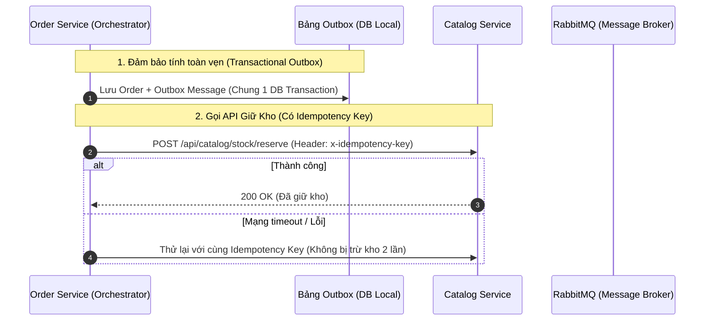

# 🎓 KẾ HOẠCH NÂNG CẤP ĐỒ ÁN TỐT NGHIỆP (ĐATN)
### Hệ Thống Sàn TMĐT Microservices & Trí Tuệ Nhân Tạo

> [!IMPORTANT]
> **Mục tiêu:** Chuyển đổi toàn diện dự án từ mức **Đồ án Thực tập Doanh nghiệp (Hoàn thành chức năng)** sang **Đồ án Tốt nghiệp Đại học (Chuẩn mực kiến trúc, tính toàn vẹn phân tán, mô hình toán học & đánh giá thực nghiệm)**.

---

## 📊 BẢNG TỔNG KẾT HIỆN TRẠNG (SCORECARD)

| Thành Phần | Trạng Thái Hiện Tại | Đánh Giá Cho ĐATN | Mức Độ Ưu Tiên |
| :--- | :--- | :--- | :---: |
| **1. Kiến trúc Microservices** | 7 services + Docker + Gateway | 🟡 **Khá:** Chạy được, nhưng thiếu Outbox Pattern và Idempotency | 🔴 **Cao** |
| **2. Giao dịch Saga** | Đang chạy REST Orchestration | 🟡 **Khá:** Cần xử lý lỗi mạng (Network Timeout) & Bù trừ tự động | 🔴 **Cao** |
| **3. Message Broker (RabbitMQ)** | Đã nối một số luồng | 🟡 **Đạt yêu cầu cơ bản:** Thiếu Dead Letter Queue (DLQ) & Retry | 🟡 **Trung bình** |
| **4. AI Recommendation** | Hashing TF + pgvector (500 dims) | 🔴 **Cần sửa:** Tài liệu mâu thuẫn số liệu, thiếu công thức User Vector | 🔴 **Cao** |
| **5. AI RAG & Chatbot** | Mới có file thiết kế lý thuyết | ⚪ **Chưa code:** Cần làm rõ phạm vi, thêm Human-in-the-loop | 🟡 **Trung bình** |
| **6. Tìm kiếm (Search)** | SQL ILIKE | ⚪ **Đang đề xuất:** Cảnh báo quá tải nếu đưa Elasticsearch vào | 🟢 **Xem xét lại** |
| **7. Báo cáo Telegram** | Cronjob chạy cuối ngày | 🟢 **Tốt:** Nên nâng cấp thành Bot Cảnh báo sự cố khẩn cấp | 🟢 **Thấp** |

---

## 🔍 PHẦN 1: CÁC LỖI SAI & ĐIỂM BẤT NHẤT CẦN SỬA NGAY

### 1.1. Lệch số chiều Vector (Vector Dimension Mismatch)

```
[rabbitmq-report.md]  ─── ghi: 384 chiều  ──┐
                                             ├── 💥 MÂU THUẪN DỮ LIỆU
[schema.prisma & code] ─── chạy: 500 chiều  ──┘
```

* **Vấn đề:** Trong [rabbitmq-report.md](file:///c:/Users/Lenovo/Desktop/do%20an/san-thuong-mai-dien-tu/docs/rabbitmq-report.md#L62) ghi vector 384 chiều, nhưng code thực tế tại [schema.prisma](file:///c:/Users/Lenovo/Desktop/do%20an/san-thuong-mai-dien-tu/backend/recommendation-service/prisma/schema.prisma#L18) và [tfidf.ts](file:///c:/Users/Lenovo/Desktop/do%20an/san-thuong-mai-dien-tu/backend/recommendation-service/src/utils/tfidf.ts#L31) lại cấu hình `vector(500)`.
* **Hậu quả:** Hội đồng chấm thi sẽ bắt lỗi số liệu không đồng nhất giữa code và báo cáo.
* **Cách sửa:** Sửa lại báo cáo thống nhất con số **500 chiều** cho bài toán Recommendation hiện tại.

---

### 1.2. Nhầm lẫn tên gọi thuật toán: "TF-IDF" vs "Hashing TF"

> [!WARNING]
> **Cảnh báo lỗi học thuật:** Trong mã nguồn `tfidf.ts`, hệ thống dùng hàm băm `djb2` để cộng dồn tần suất từ trong sản phẩm. Thuật toán này **hoàn toàn chưa có thành phần IDF (Inverse Document Frequency)** vì không lưu thống kê tổng số tài liệu trong kho.

| Tên đang ghi trong tài liệu | Bản chất thuật toán trong Code | Giải pháp cho Báo cáo ĐATN |
| :--- | :--- | :--- |
| **TF-IDF** | **Feature Hashing (djb2) + Term Frequency (TF)** | ✅ Đổi tên chính xác thành: *"Kỹ thuật Feature Hashing kết hợp Trọng số Term Frequency"* để tránh bị hội đồng trừ điểm chuyên môn. |

---

### 1.3. Trùng lặp tài liệu và file rác

- [ ] **Xóa file rác:** Tệp [~$_SHOPPING_ASSISTANT_AND_RAG.md](file:///c:/Users/Lenovo/Desktop/do%20an/san-thuong-mai-dien-tu/docs/~$_SHOPPING_ASSISTANT_AND_RAG.md) (tệp tạm rác do Word tạo ra).
- [ ] **Gộp tài liệu Saga:** Hợp nhất 2 file [SAGA_PATTERN.md](file:///c:/Users/Lenovo/Desktop/do%20an/san-thuong-mai-dien-tu/docs/SAGA_PATTERN.md) và [saga-pattern-report.md](file:///c:/Users/Lenovo/Desktop/do%20an/san-thuong-mai-dien-tu/docs/saga-pattern-report.md) thành một file tài liệu duy nhất.

---

## 🛠 PHẦN 2: CÁC NÂNG CẤP KỸ THUẬT QUAN TRỌNG CHO ĐATN

### 2.1. Nâng cấp Giao Dịch Phân Tán (Saga Pattern)



#### 3 điểm cần bổ sung vào báo cáo và mã nguồn:
1. **Idempotency Key:** Mọi request trừ kho/hoàn kho đều phải gửi kèm mã đơn (`order_id`) để Catalog Service không bị trừ kho 2 lần khi thử lại.
2. **Transactional Outbox Pattern:** Giải quyết bài toán Dual-Write (Lưu DB xong nhưng rớt mạng không gửi được Message Queue).
3. **Cơ chế Timeout bằng Message TTL:** Thay vì dùng cronjob 5 phút quét toàn bộ database, dùng **RabbitMQ Dead Letter Exchange (DLX)** với thời gian sống (TTL) 15 phút để kích hoạt tự động hủy đơn hết hạn.

---

### 2.2. Nâng cấp Phân Hệ Gợi Ý (AI Recommendation)

#### A. Công thức tính User Vector chuẩn khoa học:
Thay vì chỉ nhân hệ số cố định, bổ sung **Hàm suy giảm theo thời gian (Time-decay factor)** vào báo cáo:

$$\vec{U} = \sum_{k=1}^{M} w(e_k) \cdot e^{-\lambda (t - t_k)} \cdot \vec{V}(p_k)$$

* **$w(e_k)$**: Trọng số hành vi ($w_{PURCHASE} = 3.0, w_{CART} = 2.0, w_{VIEW} = 1.0$).
* **$\lambda$**: Hệ số suy giảm theo thời gian (Hành vi cũ giảm dần mức độ ảnh hưởng).
* **$\vec{V}(p_k)$**: Vector đặc trưng sản phẩm (500 chiều).

#### B. Thước đo đánh giá thực nghiệm (Bắt buộc phải có trong ĐATN):
* **Precision@K & Recall@K:** Tỉ lệ sản phẩm đúng sở thích nằm trong Top $K$ gợi ý.
* **NDCG@K:** Đánh giá thứ tự xếp hạng của danh sách gợi ý.
* **Thời gian phản hồi:** Đo độ trễ truy vấn của `pgvector` khi số lượng sản phẩm tăng lên 1.000, 5.000, 10.000 items.

---

### 2.3. Lời Khuyên Về Tìm Kiếm (Smart Search & Elasticsearch)

> [!TIP]
> **Tránh "Vỡ Tiến Độ" (Scope Creep):**  
> Tài liệu [SMART_SEARCH_UPGRADE.md](file:///c:/Users/Lenovo/Desktop/do%20an/san-thuong-mai-dien-tu/docs/SMART_SEARCH_UPGRADE.md) đề xuất dựng Elasticsearch + kNN + Visual Search bằng hình ảnh. Đây là khối lượng công việc quá lớn cho nhóm 3 người trong thời gian làm đồ án.  
> 
> **Phương án tối ưu cho ĐATN:**
> * Tận dụng **PostgreSQL Full-Text Search + pg_trgm** (đã có sẵn trong Postgres) để tìm kiếm Tiếng Việt không dấu và sửa lỗi chính tả.
> * Kết hợp với **pgvector** để làm Semantic Search ngay trên cùng một DB.
> * 👉 Điểm cộng lớn: Hệ thống tinh gọn, không tốn thêm RAM/CPU cho cụm Elasticsearch, chứng minh năng lực tối ưu kiến trúc.

---

## 👥 PHẦN 3: PHÂN CHIA CÔNG VIỆC NHÓM 3 NGƯỜI

```
┌────────────────────────────────────────────────────────────────────────┐
│                        PHÂN CÔNG NHIỆM VỤ ĐATN                         │
└────────────────────────────────────────────────────────────────────────┘
```

### 👤 Người A: Nền Tảng, Bảo Mật & Giám Sát Vận Hành
- [ ] Hoàn thiện Identity Service: Phân quyền RBAC (Role-Based Access Control).
- [ ] Nâng cấp Notification Service: Cấu hình **Dead Letter Queue (DLQ)** chống nghẽn email.
- [ ] Nâng cấp **Telegram Bot**: Bổ sung gửi thông báo khẩn cấp khi có giao dịch Saga bị lỗi hoặc hệ thống gặp sự cố (Alerting System).

---

### 👤 Người B (Bạn): Catalog & Hệ Thống Khuyến Nghị AI
- [ ] Đồng bộ lại số chiều Vector: Xác nhận chuẩn 500 chiều trên toàn bộ tài liệu và code.
- [ ] Chỉnh sửa lý thuyết báo cáo: Mô tả chính xác thuật toán **Feature Hashing + Term Frequency**.
- [ ] Lập trình logic User Vector: Áp dụng trọng số View/Cart/Purchase và hệ số suy giảm thời gian.
- [ ] Đo lường thực nghiệm: Viết script test độ trễ truy vấn `pgvector` và đo chỉ số gợi ý.

---

### 👤 Người C: Đơn Hàng, Giao Dịch Phân Tán (Saga) & Thanh Toán
- [ ] Chuẩn hóa tài liệu Saga: Gộp 2 file Saga hiện tại thành 1 file chuẩn.
- [ ] Bổ sung cơ chế **Idempotency Key** cho các API giữ kho/hoàn kho bên Catalog Service.
- [ ] Viết tài liệu phân tích cơ chế giải quyết bài toán Dual-Write bằng Transactional Outbox Pattern.
- [ ] Tích hợp kiểm thử luồng thanh toán VNPay/MoMo sandbox với các kịch bản lỗi mạng.

---

## 📑 PHẦN 4: KHUNG 5 CHƯƠNG BÁO CÁO ĐỒ ÁN TỐT NGHIỆP

| Chương | Tiêu Đề | Nội Dung Trọng Tâm Cần Trình Bày |
| :---: | :--- | :--- |
| **Chương 1** | **Tổng Quan & Đặt Vấn Đề** | Lý do chọn đề tài TMĐT phân tán, các thách thức về giao dịch và cá nhân hóa trải nghiệm. |
| **Chương 2** | **Cơ Sở Lý Thuyết** | Kiến trúc Microservices, Định lý CAP/BASE, Mẫu thiết kế Saga, Hàng đợi RabbitMQ, Lý thuyết Hệ khuyến nghị, Cơ sở dữ liệu Vector (`pgvector`). |
| **Chương 3** | **Phân Tích & Thiết Kế Hệ Thống** | Sơ đồ kiến trúc tổng thể, Thiết kế Database-per-Service, Luồng Saga Orchestrator & State Machine, Mô hình toán học hóa User Vector. |
| **Chương 4** | **Cài Đặt & Triển Khai** | Hiện thực hóa các service bằng Node.js/TypeScript/Prisma, Hạ tầng Docker Compose, Giao diện người dùng React 19 + Tailwind. |
| **Chương 5** | **Thực Nghiệm & Đánh Giá** | Kiểm thử tích hợp Saga, Đo đạc hiệu năng chịu tải, Đánh giá độ chính xác của hệ khuyến nghị, Kết luận & Hướng phát triển. |

---

> [!NOTE]
> File này đã được lưu tại: `docs/KE_HOACH_NANG_CAP_DO_AN_TOT_NGHIEP.md`.  
> Bạn có thể đọc trực tiếp bằng Markdown Preview của IDE (phím tắt `Ctrl + Shift + V` hoặc icon Preview ở góc trên bên phải) để có giao diện hiển thị trực quan nhất!
