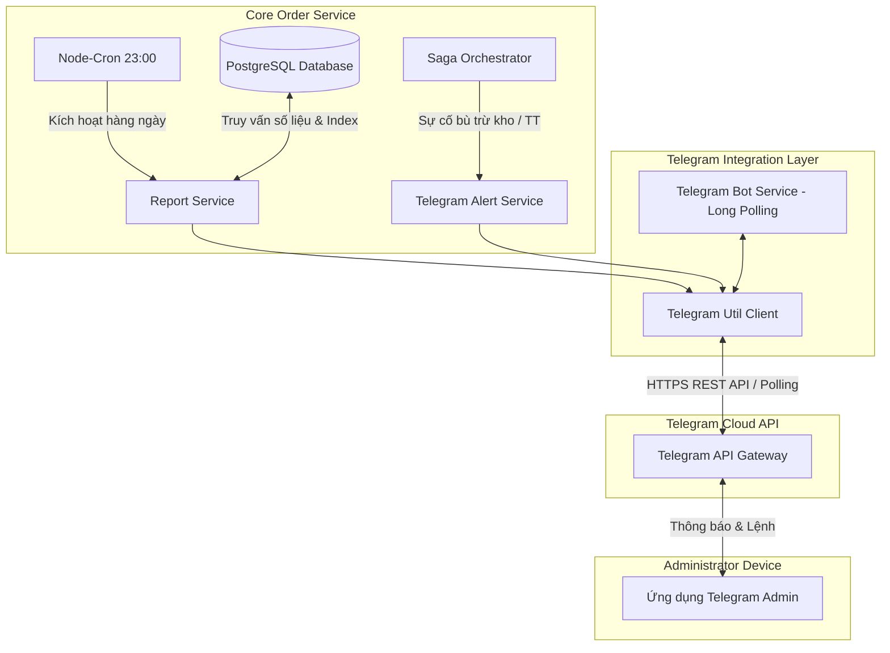
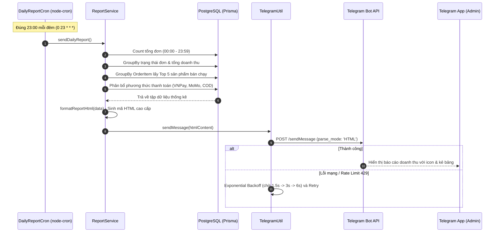
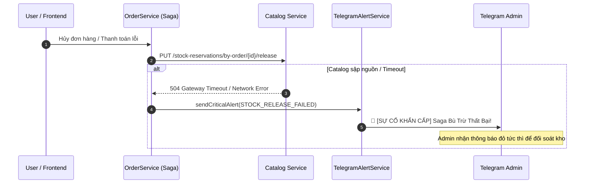
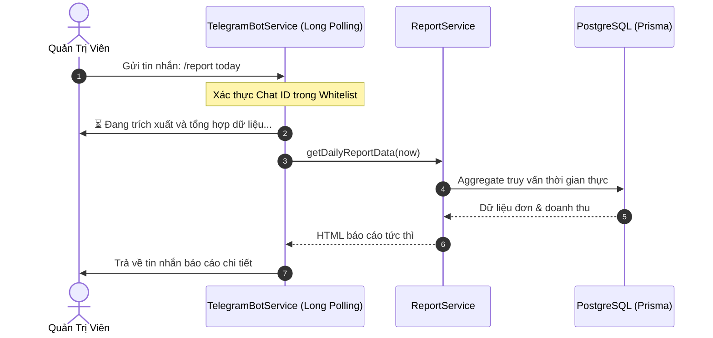

# 🎓 TÀI LIỆU KỸ THUẬT: MODULE GIÁM SÁT VẬN HÀNH & BÁO CÁO THÔNG MINH QUA TELEGRAM BOT
### Phân Hệ Giám Sát Hệ Thống Microservices & Business Intelligence (Đồ Án Tốt Nghiệp)

> [!IMPORTANT]
> **Vị trí trong Đồ án Tốt nghiệp:**  
> Module này nâng tầm từ một tác vụ nền đơn giản thành **Trung Tâm Điều Hành, Giám Sát Hệ Thống Phân Tán & Báo Cáo Kinh Doanh (E-Commerce Operations & Monitoring Center)**. Giúp Quản trị viên (Admin) nắm bắt trọn vẹn số liệu tài chính, theo dõi sức khỏe vi dịch vụ và nhận cảnh báo sự cố giao dịch Saga tức thời ngay trên ứng dụng di động Telegram.

---

## 1. Mục Tiêu & Ý Nghĩa Học Thuật / Thực Tiễn

1. **Ý nghĩa Thực tiễn Doanh nghiệp (Business Value):**
   - **Quản trị Real-time không phụ thuộc Desktop:** Ban quản trị có thể kiểm tra doanh thu, top sản phẩm và tra cứu đơn hàng ở bất cứ đâu chỉ với chiếc điện thoại thông minh.
   - **Tối ưu chi phí vận hành:** Tận dụng 100% Telegram Bot API chính thức miễn phí, độc lập hoàn toàn, không phụ thuộc vào các nền tảng kéo thả trả phí như Zapier hay Make.com.
2. **Ý nghĩa Kỹ thuật trong Đồ án Microservices (Engineering Rigor):**
   - **Giám sát giao dịch phân tán (Saga Watchdog):** Tự động phát hiện và gửi cảnh báo khẩn cấp (Critical Alert) khi các bước bù trừ (Compensating Transactions) bị lỗi hoặc hệ thống thanh toán gặp sự cố.
   - **Tương tác 2 chiều (Bidirectional Operations):** Không chỉ là luồng đẩy 1 chiều (Server-Push), hệ thống hỗ trợ cơ chế **Long-Polling** nhận lệnh và tương tác tức thời từ Admin (`/report`, `/order`, `/health`).
   - **Chuẩn công nghiệp (Enterprise Reliability):** Tích hợp thuật toán thử lại theo hàm mũ (**Exponential Backoff Retry**) tự động khắc phục hiện tượng nghẽn mạng và xử lý Rate Limiting (HTTP 429).

---

## 2. Kiến Trúc & Sơ Đồ Tuần Tự (Sequence Diagrams)

### 2.1. Sơ đồ Tổng Thể Module



---

### 2.2. Luồng 1: Báo Cáo Tự Động Định Kỳ (Daily Business Intelligence Report)



---

### 2.3. Luồng 2: Cảnh Báo Sự Cố Giao Dịch Phân Tán (Saga Failure Alert)



---

### 2.4. Luồng 3: Tương Tác 2 Chiều với Bot (Interactive Admin Commands)



---

## 3. Danh Mục Lệnh Tương Tác (Telegram Commands)

Sau khi cấu hình, Quản trị viên chỉ cần mở ứng dụng Telegram và gõ các lệnh sau:

| Lệnh (Slash Command) | Chức năng | Mô tả chi tiết |
| :--- | :--- | :--- |
| `/start` hoặc `/help` | Menu trợ giúp | Hiển thị thông tin chào mừng và danh mục câu lệnh điều hành. |
| `/report` | Báo cáo hôm nay | Trích xuất doanh thu, số lượng đơn và top sản phẩm tính tới thời điểm hiện tại. |
| `/report yesterday` | Báo cáo hôm qua | Xem lại toàn bộ số liệu tổng kết của ngày hôm trước để so sánh tăng trưởng. |
| `/order <mã_UUID>` | Tra cứu đơn hàng | Xem trạng thái chi tiết, địa chỉ giao hàng, phương thức thanh toán & danh sách món hàng. |
| `/health` | Kiểm tra hạ tầng | Kiểm tra độ trễ Database PostgreSQL, dung lượng RAM (RSS), Heap memory và thời gian Uptime. |
| `/test_alert` | Thử nghiệm cảnh báo | Bắn thử tin nhắn cảnh báo sự cố khẩn cấp để kiểm tra kênh liên lạc. |

---

## 4. Đặc Tả REST API (Dành Cho Web Admin Dashboard)

Module cung cấp sẵn các endpoints RESTful tại `order-service` (Port `3004`):

### 1. `GET /api/telegram/status`
* **Mục đích:** Kiểm tra trạng thái hoạt động của Bot, Bot info, lịch trình Cron và Long-polling.
* **Response mẫu:**
  ```json
  {
    "success": true,
    "data": {
      "isConfigured": true,
      "botInfo": { "id": 123456789, "username": "ecommerce_monitor_bot", "first_name": "EcomBot" },
      "defaultChatId": "Đã cấu hình",
      "botPollingRunning": true,
      "cronRunning": true,
      "cronExpression": "0 23 * * *"
    }
  }
  ```

### 2. `GET /api/telegram/preview-report?date=2026-10-11`
* **Mục đích:** Xem trước số liệu JSON và nội dung định dạng HTML mà không cần gửi tin nhắn thực tế.

### 3. `POST /api/telegram/send-report`
* **Mục đích:** Kích hoạt gửi báo cáo ngay lập tức (dành cho nút bấm *"Gửi báo cáo ngay"* trên Admin Dashboard).

### 4. `POST /api/telegram/test-alert`
* **Mục đích:** Bắn thử nghiệm tin nhắn cảnh báo đỏ lên Telegram.

---

## 5. Hướng Dẫn Cài Đặt Thực Tế Từng Bước (Chỉ Mất 2 Phút)

### Bước 1: Tạo Bot Telegram (Lấy Token)
1. Mở ứng dụng Telegram, tìm kiếm người dùng **`@BotFather`** (có tích xanh chính thức).
2. Gửi tin nhắn: `/newbot`.
3. Nhập tên hiển thị của bot (ví dụ: `ECommerce Monitor Bot`).
4. Nhập username kết thúc bằng `bot` (ví dụ: `my_ecom_admin_bot`).
5. **BotFather** sẽ cung cấp cho bạn một chuỗi **HTTP API Token**, có dạng:
   ```
   7182938491:AAH8Fjkldsf9348Jkldsfjklsdf9348
   ```

### Bước 2: Lấy Chat ID Của Quản Trị Viên
1. Tìm bot **`@userinfobot`** trên Telegram và bấm `/start`.
2. Bot sẽ trả về `Id` của bạn (ví dụ: `123456789`).
*(Hoặc bạn chỉ cần bật hệ thống lên, mở bot vừa tạo ở Bước 1 và gõ `/start`, bot sẽ tự động báo mã Chat ID của bạn).*

### Bước 3: Khai báo vào file `.env` của `order-service`
Tạo hoặc mở file `backend/order-service/.env` và thêm:
```env
TELEGRAM_BOT_TOKEN="7182938491:AAH8Fjkldsf9348Jkldsfjklsdf9348"
TELEGRAM_CHAT_ID="123456789"
TELEGRAM_WHITELIST_CHATS="123456789"
TELEGRAM_REPORT_CRON="0 23 * * *"
```

### Bước 4: Khởi động và kiểm tra
```powershell
cd backend/order-service
npm run dev
```
Terminal sẽ hiển thị:
```
Database connected successfully
[DailyReportCron] 📅 Đã lập lịch gửi báo cáo tự động qua Telegram với biểu thức: "0 23 * * *"
[TelegramBotService] 🚀 Bot @my_ecom_admin_bot đã sẵn sàng nhận lệnh tương tác 2 chiều!
Order Service is running on port 3004
```

---

## 6. Mẫu Tin Nhắn Báo Cáo Thực Tế Trên Telegram

```
📊 BÁO CÁO KINH DOANH NGÀY 11/10/2026
Hệ Thống Sàn Thương Mại Điện Tử Microservices
━━━━━━━━━━━━━━━━━━━━━━

💰 TÀI CHÍNH & DOANH THU:
• Doanh thu thực nhận: 12.500.000 ₫
• Tổng giá trị đơn đang chạy: 18.200.000 ₫

📦 TÌNH HÌNH ĐƠN HÀNG:
• Tổng đơn phát sinh: 15 đơn
• ✅ Đã giao hoàn tất: 8 đơn
• 🚚 Đang vận chuyển: 4 đơn
• ⏳ Chờ xử lý / xác nhận: 2 đơn
• ❌ Đơn đã hủy: 1 đơn
• 🎯 Tỷ lệ đơn tích cực: 80.0%

💳 THANH TOÁN HỢP LỆ:
• 💳 VNPAY: 9 đơn (11.000.000 ₫)
• 💵 Tiền mặt (COD): 5 đơn (7.200.000 ₫)

🏆 TOP SẢN PHẨM BÁN CHẠY:
🥇 Bàn phím cơ không dây FL-Esports
    ↳ Đã bán: 6 cái • Thu về: 7.200.000 ₫
🥈 Chuột Gaming Logitech G Pro X
    ↳ Đã bán: 4 cái • Thu về: 6.800.000 ₫
🥉 Tai nghe Sony WH-1000XM5
    ↳ Đã bán: 2 cái • Thu về: 8.500.000 ₫

━━━━━━━━━━━━━━━━━━━━━━
⏱ Báo cáo tạo lúc: 23:00:01 11/10/2026
🤖 Trợ lý vận hành tự động (Order Service Monitoring)
```

---

## 7. Bộ Câu Hỏi Phản Biện & Kịch Bản Bảo Vệ ĐATN

| Câu hỏi từ Hội đồng chấm thi | Câu trả lời chuẩn kỹ sư & học thuật |
| :--- | :--- |
| **Q1: Tại sao em không dùng các giải pháp no-code như Zapier hay n8n?** | *Dạ thưa Thầy/Cô, việc tự xây dựng module này giúp hệ thống độc lập 100%, không phát sinh chi phí duy trì SaaS, loại bỏ rủi ro rò rỉ dữ liệu doanh thu qua bên thứ ba và cho phép nhúng trực tiếp vào luồng bắt lỗi Saga compensation nội bộ.* |
| **Q2: Tại sao em chọn Long Polling thay vì Webhook cho Telegram Bot?** | *Dạ thưa Thầy/Cô, Webhook yêu cầu server phải có Domain công khai kèm SSL (HTTPS), điều này gây khó khăn khi triển khai trong môi trường mạng nội bộ doanh nghiệp hoặc môi trường Docker local. Long Polling hoạt động theo cơ chế Outbound connection an toàn, không cần mở Port Firewall hay dùng ngrok.* |
| **Q3: Cơ chế bảo mật số liệu kinh doanh trên Telegram như thế nào?** | *Hệ thống áp dụng cơ chế **Chat ID Whitelisting**. Bất kỳ tin nhắn nào đến từ người dùng không nằm trong danh sách trắng sẽ bị từ chối ngay lập tức (`403 Unauthorized`) và không để lộ bất kỳ thông tin nào về doanh thu hay đơn hàng.* |
| **Q4: Khi dữ liệu đơn hàng lên đến hàng triệu đơn, cronjob 23h có làm chậm hệ thống không?** | *Dạ thưa Thầy/Cô, hệ thống chỉ lọc trong khoảng thời gian 24h của ngày hôm đó (`gte startOfDay, lte endOfDay`). Kết hợp với đánh chỉ mục B-Tree trên trường `created_at` và `status`, thời gian truy vấn chỉ mất dưới vài chục mili-giây, không ảnh hưởng đến luồng giao dịch chính.* |

---

## 8. Kết Luận
Module **Giám sát & Báo cáo Thông minh qua Telegram Bot** đã giải quyết trọn vẹn cả 3 bài toán:
1. **Business Intelligence:** Báo cáo tài chính tự động mỗi đêm.
2. **DevOps & System Observability:** Cảnh báo lỗi phân tán Saga & giám sát sức khỏe vi dịch vụ.
3. **Interactive Operations:** Tra cứu dữ liệu trực tiếp 2 chiều từ app di động.
Giúp nâng cao đáng kể giá trị thực tiễn và điểm số công nghệ cho Đồ án Tốt nghiệp!
